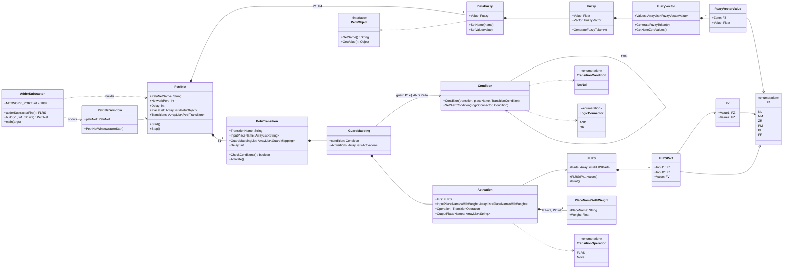

# Fuzzy Lab 1 – FLETPN: solutions

Code:
- `src/DCS_FuzzyLab/Inversor.java` – the teacher's Inversor (exercise 1)
- `src/DCS_FuzzyLab/AdderSubtractor.java` – the adder/subtractor (exercise 2)

Both run on the teacher's framework in [`../framework/all-petri-nets`](../framework/all-petri-nets/ORIGIN.md). See
[README.md](README.md) for where each file comes from and how to run it.

To try other values, change `SetValue(new Fuzzy(...))` for P1 and P2 and the weights in `PlaceNameWithWeight`. You can
also press Start and send P1 and P2 from `InputFuzzy` to the net's port.

The fuzzy sets are FS = {NL, NM, ZR, PM, PL}, centred at −1, −0.5, 0, 0.5 and 1, with the triangular membership
functions of figure 2.1. The framework computes a rule's strength as the product s = μ1·μ2 and defuzzifies with the
centre of gravity x = Σ xᵢ·sᵢ / Σ sᵢ.

---

## 1. Inversor – tests

Model: x3 = −w1·x1, x4 = −w2·x2, clamped to [−1, 1]. FLRS = Table 2.

All values below come from firing T1 of the net. Each output token is written as its value followed by
<μNL, μNM, μZR, μPM, μPL>.

| x1 | w1 | x2 | w2 | x3 (P3) | x4 (P4) | expected |
|---:|---:|---:|---:|---|---|---|
| 0.1 | 1 | 0.2 | 2 | −0.1 <0, 0.2, 0.8, 0, 0> | −0.4 <0, 0.8, 0.2, 0, 0> | −0.1, −0.4 (figure 5.3) |
| 0.3 | 1 | 0.7 | 1 | −0.3 <0, 0.6, 0.4, 0, 0> | −0.7 <0.4, 0.6, 0, 0, 0> | −0.3, −0.7 |
| −0.6 | 1 | 0.4 | 1 | 0.6 <0, 0, 0, 0.8, 0.2> | −0.4 <0, 0.8, 0.2, 0, 0> | 0.6, −0.4 |
| 0.8 | 2 | −0.9 | 1 | −1.0 <1, 0, 0, 0, 0> | 0.9 <0, 0, 0, 0.2, 0.8> | −1 (w1·x1 = 1.6 > 1), 0.9 |
| 0 | 1 | −0.25 | 1 | 0.0 <0, 0, 1, 0, 0> | 0.25 <0, 0, 0.5, 0.5, 0> | 0, 0.25 |

The Inversor is exact. Each output depends on only one input, and the table maps every zone to its mirror zone, so the
centre of gravity gives back −w·x exactly.

---

## 2. Adder / Subtractor

Model: x3 = w1·x1 + w2·x2 and x4 = w1·x1 − w2·x2, both clamped to [−1, 1]. FLRS = Table 3.

### Class diagram

The Petri net itself is P1 (x1) and P2 (x2) → T1 [guard P1 ≠ ϕ AND P2 ≠ ϕ, FLRS Table 3] → P3 (x3), P4 (x4).

### Tests

These values also come from firing T1 of the net.

| x1 | w1 | x2 | w2 | x3 (P3) | x4 (P4) | exact x3, x4 |
|---:|---:|---:|---:|---|---|---|
| 0.2 | 1 | 0.3 | 2 | **0.76** <0, 0, 0, 0.48, 0.52> | **−0.4** <0, 0.8, 0.2, 0, 0> | 0.8, −0.4 (exercise 3) |
| 0.1 | 1 | 0.2 | 1 | 0.3 | −0.1 | 0.3, −0.1 |
| 0.4 | 1 | −0.3 | 1 | 0.1 | 0.7 | 0.1, 0.7 |
| −0.5 | 1 | −0.5 | 1 | −1.0 | 0.0 | −1 (sum = −1), 0 |
| 0.7 | 1 | 0.6 | 1 | 1.0 | 0.1 | 1 (1.3 clamped), 0.1 |
| 0.3 | 2 | 0.25 | 1 | 0.8 | 0.35 | 0.85, 0.35 |
| −0.2 | 1 | 0.6 | 1 | 0.4 | −0.76 | 0.4, −0.8 |
| 0 | 1 | 0 | 1 | 0.0 | 0.0 | 0, 0 |

Most results are exact. A small error (0.04–0.05) appears when one input is near the PL/NL end and the true result is
above 1 for some of the fired rules. Table 3 has to clamp those rules to PL or NL, so the centre of gravity is pulled
slightly towards the middle. This is the normal approximation error of a 5-zone fuzzy controller.

---

## 3. Hand calculation (Table 3): x1 = 0.2, w1 = 1, x2 = 0.3, w2 = 2

**Step 1 – weights:**
- x'1 = x1·w1 = 0.2·1 = 0.2
- x'2 = x2·w2 = 0.3·2 = 0.6, which is in [−1, 1], so no clamping is needed.

**Step 2 – fuzzification (figure 2.1):**
- x'1 = 0.2 lies between ZR (0) and PM (0.5):
  - μZR = (0.5 − 0.2)/0.5 = 0.6
  - μPM = 0.2/0.5 = 0.4
  - so μx'1 = <0, 0, 0.6, 0.4, 0>
- x'2 = 0.6 lies between PM (0.5) and PL (1):
  - μPM = (1 − 0.6)/0.5 = 0.8
  - μPL = (0.6 − 0.5)/0.5 = 0.2
  - so μx'2 = <0, 0, 0, 0.8, 0.2>

**Step 3 – rules that fire (Table 3)** and their strength s = μ1·μ2:

| rule | x1 zone | x2 zone | ⇒ x3, x4 | s |
|---|---|---|---|---|
| r1 | ZR (0.6) | PM (0.8) | PM, NM | 0.6·0.8 = 0.48 |
| r2 | ZR (0.6) | PL (0.2) | PL, NL | 0.6·0.2 = 0.12 |
| r3 | PM (0.4) | PM (0.8) | PL, ZR | 0.4·0.8 = 0.32 |
| r4 | PM (0.4) | PL (0.2) | PL, NM | 0.4·0.2 = 0.08 |

Σs = 0.48 + 0.12 + 0.32 + 0.08 = 1.00, so the result is already normalised.

**Step 4 – defuzzification (centre of gravity),** with NL = −1, NM = −0.5, ZR = 0, PM = 0.5, PL = 1:

- x3 = (PM·0.48 + PL·0.12 + PL·0.32 + PL·0.08) / 1
     = (0.5·0.48 + 1·0.12 + 1·0.32 + 1·0.08)
     = 0.24 + 0.52 = **0.76 ≈ 0.8**
- x4 = (NM·0.48 + NL·0.12 + ZR·0.32 + NM·0.08) / 1
     = (−0.5·0.48 − 1·0.12 + 0 − 0.5·0.08)
     = −0.24 − 0.12 − 0.04 = **−0.40**

The program gives the same result: P3 = 0.76 <0, 0, 0, 0.48, 0.52> and P4 = −0.4 <0, 0.8, 0.2, 0, 0>.

The exact values are 0.2 + 0.6 = 0.8 and 0.2 − 0.6 = −0.4. x4 is exact. x3 is about 0.04 low because rule r3
(PM + PM = 1.0) and rule r4 (PM + PL = 1.5, clamped) both land on PL = 1, so part of the weight that would sit above the
PL centre is lost.

With s = min(μ1, μ2) instead of the product, the strengths are 0.6, 0.2, 0.4 and 0.2, with Σs = 1.4. That gives
x3 = 1.1/1.4 ≈ 0.79 and x4 = −0.6/1.4 ≈ −0.43, which is also ≈ 0.8 and −0.4.

---

## Verification of knowledge

**1) What are fuzzy sets and how do we work with them?**
In a classical set an element either belongs to the set or it doesn't. In a fuzzy set it belongs to a degree
μ(x) ∈ [0, 1]. A variable is described by a few overlapping linguistic sets, here NL, NM, ZR, PM and PL, and one value
can belong to two neighbouring sets at once (for example ZR 0.6 and PM 0.4). We work with fuzzy sets through
IF–THEN rules such as "IF x1 is ZR AND x2 is PM THEN x3 is PM". AND is evaluated as a product or a minimum of the
degrees. Several rules fire at the same time, each with its own strength, and their conclusions are combined.

**2) How do we change from real variables to fuzzy variables?**
By fuzzification. The crisp value is first multiplied by its weight and clamped to [−1, 1]. It is then placed on the
triangular membership functions, and the degree for each set is read off. With 5 triangles, at most two neighbouring
sets are non-zero, and their degrees add up to 1, e.g. 0.6 → <0, 0, 0, 0.8, 0.2>. Going back is defuzzification:
x = Σ xᵢ·μᵢ / Σ μᵢ (centre of gravity).

**3) What is a Fuzzy Logic Enhanced Time Petri Net and what is it used for?**
It is a Time Petri Net whose tokens are fuzzy vectors and whose transitions run a fuzzy rule table (FLRS). Places hold
the variables, arcs carry weights wᵢ, and transitions have guards and delays. When a transition fires, it takes the
input tokens, defuzzifies them, multiplies them by the arc weights, fuzzifies them again, applies the FLRS, normalises
the result and puts one token in each output place. FLETPNs are used to model and run fuzzy controllers, for
example the fuzzy part of a control loop (figure 2.2). They can model synchronous and asynchronous reactions to
continuous and discrete changes, and they can be connected over the network into distributed control systems: each net
has a port, and other nets or `InputFuzzy` send tokens to its input channels.

**4) What is a token in a place pᵢ of the FLETPN?**
It is the vector of membership degrees of the place's variable xᵢ to the fuzzy sets, <μNL, μNM, μZR, μPM, μPL>,
normalised so that the degrees add up to 1. In the framework it is a `DataFuzzy` that holds a `Fuzzy` object, which
contains both the crisp `Value` and the `FuzzyVector`. An empty place (`null`) means the variable has no value yet,
and in that case a guard such as `P1 ≠ ϕ` is false.

**5) What is the use of the Fuzzy Logic Rule Set tables?**
The FLRS is the knowledge base of the transition. For every combination of input zones (5 × 5 = 25 cells for two
inputs) it gives the output zones. By changing only the table, the same net computes a different function: Table 2
gives an inversor and Table 3 gives an adder/subtractor. It encodes the control law in linguistic form without an
analytic formula. The table's resolution (5 zones) also sets the approximation error, as the 0.76 vs 0.8 case above
shows.
